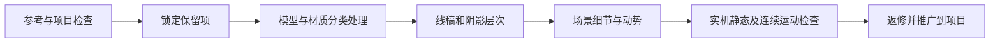

# Godot Moebius Rendering

**面向 Godot 3D 场景的莫比斯启发式美术工作流与 AI 代理 skill。**

把模型形态、线稿、色块阴影、场景细节和动态画面检查放在同一个流程里。适合改善程序化场景的机械感，也适合排查描边、阴影、远景线重和移动时的画面问题。

> A reference-driven AI-agent skill for Moebius-inspired Godot environments, with category-aware modeling guidance, distance-aware ink, scene enrichment and motion-quality checks.

它是一套可执行的工作方法，加上一份经过实际项目验证的屏幕描边着色器参考；并不是“导入任意游戏就一键转换”的插件，也不包含完整自动建模工具。

## 适合处理什么

- **模型太机械**：按岩石、植物、建筑与角色分别检查形态、连接、法线和受保护区域，而不是统一随机扰动。
- **线稿没有层次**：区分轮廓、结构线、明暗分界和投影边界，遵循近粗远细，保留角色辨识度。
- **场景太空或细节太乱**：先处理大、中、小形态，再按地形、建筑用途和行走路线组织草丛、碎石与生活细节。
- **静态好看、移动发糊**：分开检查角色移动、相机移动、采样、抗锯齿和线条附着，不用一张截图代替动态验收。
- **修改后反复回退**：保留已经认可的色调和阴影，记录竖线、圆顶方块阴影、缺失投影等案例的诊断与回归条件。

## 工作流程



已有游戏的改造应从真实工程开始。需要副本时，先复制、校验并隔离存档，再修改；不要用一个简化演示替代原工程。

## 使用

这是一个包含 `SKILL.md` 的代理技能目录。克隆或下载仓库，保留目录结构，将它放入你使用的代理技能目录。

对于采用 `~/.codex/skills` 目录的环境，可以使用：

```powershell
git clone https://github.com/cwyf/godot-moebius-rendering.git "$HOME/.codex/skills/godot-moebius-rendering"
```

调用示例：

```text
使用 $godot-moebius-rendering 检查我的 Godot 工程。
先识别实际版本和渲染器，在测试副本中修改。
保留当前色调、角色、玩法和声音；先定位动态清晰度问题，
再处理模型机械感、近粗远细的线稿和场景细节。
交付实机对照、连续运动检查，以及仍未解决的项目。
```

只想分析问题、研究参考或修改 skill 时，也可以明确限定范围；这不等于授权修改游戏。

## 内容导航

| 内容 | 文件 |
| --- | --- |
| 技能入口与执行边界 | [SKILL.md](SKILL.md) |
| 全局改造流程 | [global-transformation.md](references/global-transformation.md) |
| 门窗接缝、棚架连接与梯子落点 | [architectural-joinery.md](references/architectural-joinery.md) |
| 按类别改善程序化模型 | [organic-modeling.md](references/organic-modeling.md) |
| 细节组织与场景生活感 | [scene-enrichment.md](references/scene-enrichment.md) |
| 线条、动态清晰度与附着 | [line-and-motion.md](references/line-and-motion.md) |
| 近粗远细与远景层次 | [distance-and-depth.md](references/distance-and-depth.md) |
| 渲染问题与故障排查 | [rendering.md](references/rendering.md) |
| 回归案例与项目约束示例 | [regression-cases.md](references/regression-cases.md) |
| 实机验收与交付 | [outcome-acceptance.md](references/outcome-acceptance.md) |
| 研究与引用 | [research.md](references/research.md)、[sources.md](references/sources.md) |
| 可复用的屏幕描边参考 | [distance_ink.gdshader](assets/godot4-forward-plus/distance_ink.gdshader) |

## 着色器与适用范围

附带着色器在 **Godot 4.7.2、Forward+** 的项目中检查过，覆盖 1280×720 与 1600×900 的近景、远景、室内和相机环绕视图。它使用深度与法线边缘检测，包含连续地面误描边过滤和距离感知的线稿覆盖控制。

集成需要注册共享参数、设置全屏绘制、核对透明物体与 UI 顺序，并处理项目原有描边。详细说明见 [距离线重参考](references/distance-and-depth.md)。仅复制着色器不会自动改变材质内部的明暗线、模型或场景组织。

- 法线缓冲输入依赖 Forward+；**不将它描述为已验证的 Compatibility / Web 方案**。
- 对其他引擎、不同 Godot 版本、绑定模型和额外渲染效果，需要适配与复查。
- 相机、场景尺度和目标分辨率会影响参数；示例数值不是通用答案。
- 没有完成全平台性能测试，也不承诺单轮达到某位艺术家的绘画效果。

## 参考与归属

本项目由真实 Godot 场景中的 AI 辅助制作、调试与复盘整理而来。莫比斯的艺术作品、技术视频和研究中提及的第三方项目用于学习与标明来源；不代表合作、认可或官方关联。

**不包含参考艺术图片、第三方游戏资产或被研究仓库的实现代码。** 研究来源及证据边界见 [sources.md](references/sources.md) 和 [research.md](references/research.md)。

## 反馈

提交问题时，请提供 Godot 版本、渲染器、实际分辨率、预期与实际效果，以及相关材料或最小可复现片段。动态问题请尽量附上连续画面；不要提交密钥、私人项目文件或无权公开的素材。

## 许可证

本仓库的技能文档与附带参考着色器使用 [MIT License](LICENSE)。外链参考作品及第三方项目保留各自权利，不包含在本仓库授权中。
